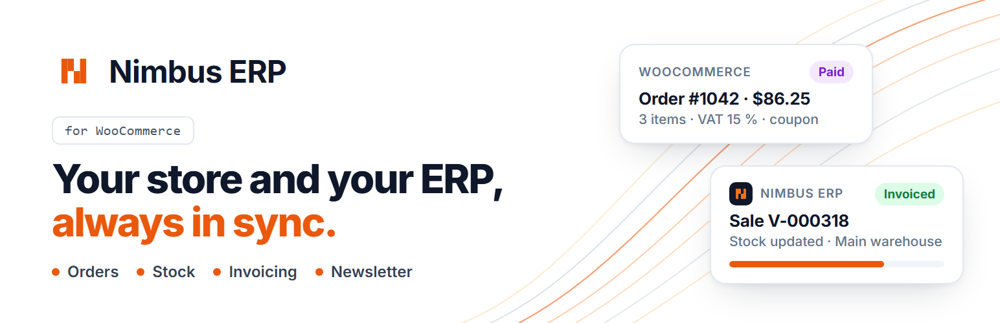
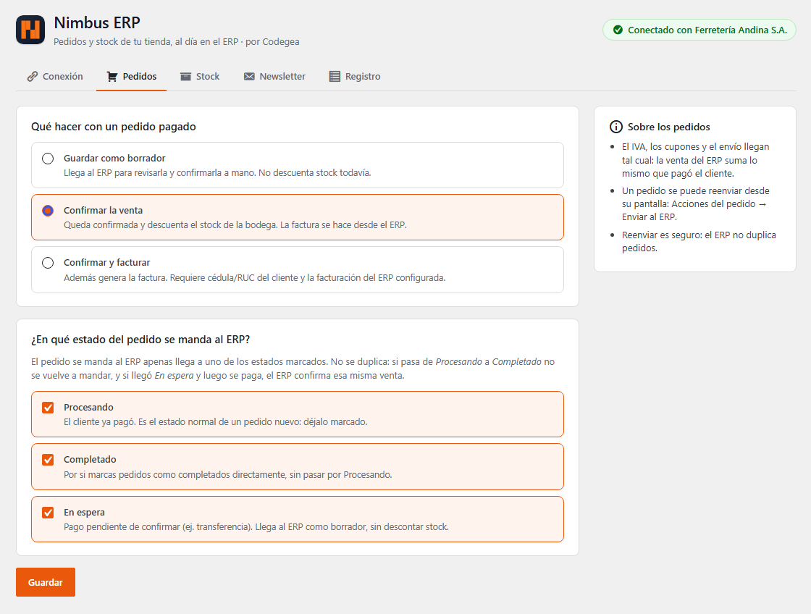

  
  
  
  
  

# Nimbus ERP for WooCommerce

Conecta una tienda **WooCommerce** con **Nimbus ERP**: los pedidos pagados llegan al ERP como ventas (en borrador, confirmadas o facturadas), el stock de la tienda sigue a una bodega del ERP y las suscripciones al newsletter llegan con doble opt-in. Desarrollado por [Codegea](https://codegea.com) (el ERP es `codegeaec/crm-erp`, plugin `wordpress`).

**Descargar:** [último release](https://github.com/codegeaec/nimbus-erp-for-woocommerce/releases/latest/download/nimbus-erp-for-woocommerce.zip) · Web: [codegea.com](https://codegea.com)

| Dirección | Qué viaja | Cómo |
|---|---|---|
| Tienda → ERP | Pedidos pagados | Este plugin (webhook firmado, reintentos con Action Scheduler) |
| Tienda → ERP | Stock cambiado a mano en WooCommerce (opcional) | Este plugin |
| Tienda → ERP | Suscripciones al newsletter (casilla del checkout y shortcode, opcional) | Este plugin; el ERP manda la confirmación |
| ERP → Tienda | Productos, precios, stock, marcas, categorías, tags, fotos | El ERP, por la API REST de WooCommerce |

## Pantallas (WooCommerce → Nimbus ERP)

- **Conexión**: URL del ERP y secreto (los da el ERP en Configuración → Plugins → WordPress / WooCommerce →
  Pedidos). «Probar conexión» trae el nombre de la empresa y sus bodegas.
- **Pedidos**: qué hacer con un pedido pagado — borrador, confirmar la venta (descuenta stock) o confirmar y
  facturar — y en qué estados se envía. Cada pedido tiene la acción «Enviar al ERP».
- **Stock**: de qué bodega del ERP sale el stock de la tienda y si los cambios hechos a mano en WooCommerce se
  pasan al ERP.
- **Newsletter**: casilla «Quiero recibir novedades» en el checkout (clásico y de bloques, sin marcar) con su
  texto, y el shortcode `[nimbus_erp_newsletter]` (`button="…"`, `name="no"`). Requiere el plugin Newsletter
  activo en el ERP.
- **Registro**: los últimos 50 envíos.

## Contrato con el ERP

Todas las llamadas son `POST {ERP}/api/plugins/wordpress/webhook/<endpoint>` con el body firmado:
`X-WC-Signature: sha256=<hmac_sha256(body, secreto)>`.

- `ping` → `{ company, tenant, warehouses[{ id, code, name, is_main }], stock_warehouse_id, orders_require_review, newsletter }`
- `orders` → ver `Nimbus_ERP_Orders::payload()` (montos sin impuestos + tasa cobrada por línea, total del pedido,
  `order_mode`, `warehouse_id`, `coupons: [{ code, discount }]` para que Fidelidad cuente los usos).
- `stock` → `{ items: [{ sku, stock }], warehouse_id }`
- `newsletter` → `{ email, name, consent, consent_text, ip }` (IP del cliente) → `{ ok, message }`. El ERP deja
  el contacto «Por confirmar» y le manda el correo de confirmación (doble opt-in).

El ERP manda el header `X-Nimbus-Erp` en sus llamadas a la API REST: así este plugin no le devuelve los cambios
de stock que hizo el propio ERP.

Filtros: `nimbus_erp_order_payload`, `nimbus_erp_client_ruc` (cédula/RUC guardada en otro campo del checkout).

## Desarrollo

El laboratorio del ERP (`pnpm wp:lab` en crm-erp) instala este plugin desde `../nimbus-erp-for-woocommerce`.

## Publicar una versión

1. Subir la versión en `nimbus-erp-for-woocommerce.php` (cabecera `Version` y `NIMBUS_ERP_VERSION`) y en `readme.txt`
   (`Stable tag` + Changelog).
2. `git tag vX.Y.Z && git push --tags`: el workflow `Release` comprueba que las versiones coincidan y publica
   `nimbus-erp-for-woocommerce.zip`.
3. El ERP descarga siempre el último:
   `https://github.com/codegeaec/nimbus-erp-for-woocommerce/releases/latest/download/nimbus-erp-for-woocommerce.zip`.

Licencia GPL v2 o posterior (requisito del directorio de WordPress.org; ver `readme.txt` y `LICENSE`).

## Ícono, banner y capturas de WordPress.org

`.wordpress-org/` tiene los archivos de la ficha del directorio (`icon-128x128.png`, `icon-256x256.png`, `icon.svg`,
`banner-772x250.png`, `banner-1544x500.png`, `screenshot-1..5.png`, en el orden de `== Screenshots ==` del `readme.txt`).
No van en el zip del plugin (`export-ignore`): se suben a la carpeta `assets/` del SVN de WordPress.org, a mano o con la
acción `10up/action-wordpress-plugin-deploy`, que los toma de esta carpeta.
